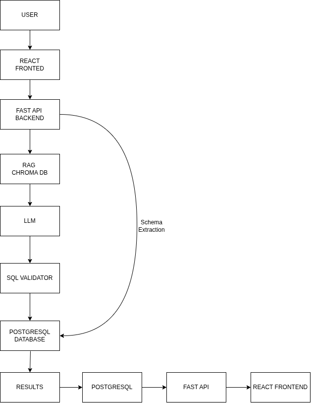

# 🚀 QueryPilotAI — AI-Powered Text-to-SQL Assistant

**QueryPilotAI** is an AI-powered web application that converts natural-language questions into SQL queries, helping users interact with databases without needing advanced SQL knowledge.

🔗 **Live Demo:** https://query-pilot-ai-iota.vercel.app  
⚙️ **Backend API:** https://querypilotai-backend.onrender.com

## ✨ Features

- 🤖 **Natural Language to SQL** — Convert plain-English questions into SQL queries.
- 🔗 **Database Connectivity** — Connect supported PostgreSQL databases.
- 🛡️ **SQL Validation** — Validate generated queries before execution.
- 🔄 **SQL Error Recovery** — Help recover from SQL errors.
- ⚡ **Query Optimization** — Support for improving query efficiency.
- 👤 **User Authentication** — Register, log in, and manage your account.
- 📜 **Query History** — Review previously generated queries.
- ⭐ **Saved Queries** — Save and reuse useful SQL queries.
- ⚙️ **Account Settings** — Manage profile and password settings.
- 📱 **Responsive UI** — Access the application on desktop and mobile.

## 🏗️ System Architecture



## 🛠️ Tech Stack

**Frontend**
- React
- Vite
- CSS

**Backend**
- Python
- FastAPI
- SQLAlchemy
- JWT Authentication

**Database**
- PostgreSQL
- Neon

**AI**
- Groq API

**Deployment**
- Vercel — Frontend
- Render — Backend

## 🚀 Run Locally

### 1. Clone the Repository

```bash
git clone https://github.com/piyush-1234567/QueryPilotAi.git
cd QueryPilotAi
```

### 2. Set Up the Backend

```bash
cd backend
python -m venv venv
source venv/bin/activate
pip install -r requirements.txt
```

Create a `.env` file inside the `backend/` directory:

```env
DATABASE_URL=your_postgresql_connection_string
GROQ_API_KEY=your_groq_api_key
JWT_SECRET=your_secret_key
```

Start the backend server:

```bash
uvicorn main:app --reload
```

Backend API documentation: `http://127.0.0.1:8000/docs`

### 3. Set Up the Frontend

Open a new terminal:

```bash
cd frontend
npm install
```

Create a `.env` file inside the `frontend/` directory:

```env
VITE_API_URL=http://127.0.0.1:8000
```

Start the frontend:

```bash
npm run dev
```

Open the local URL provided by Vite in your browser.

## 🔐 Security

- Never commit API keys, database credentials, or JWT secrets to GitHub.
- Store sensitive configuration in environment variables.
- Use appropriate database permissions.
- Review generated SQL before executing queries against important data.

## 🗺️ Future Improvements

- Support for additional database systems.
- Advanced query optimization.
- Improved SQL error recovery.
- Interactive data visualizations.
- Stronger database isolation and security controls.

## 👨‍💻 Author

**Piyush Jain**  
B.Tech — Computer Science Engineering (AI/ML)

---

⭐ If you find QueryPilotAI interesting, consider starring the repository!